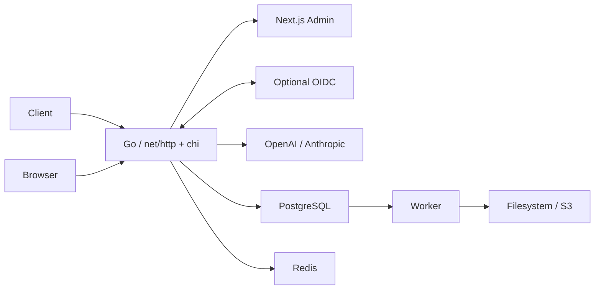

# Architecture

This is a modular Go service with a separate archive worker and a Next.js administrative UI. The HTTP routing layer uses chi and standard `http.Handler` middleware. PostgreSQL is authoritative for credentials, sessions, catalog, budgets, request state, encrypted capture events and audits. Redis supplies distributed RPM and concurrent-request admission. No queue broker is needed in Phase 1.

## Repository boundaries

- `cmd/gateway`, `cmd/worker`, `cmd/migrate`: executable entry points.
- `internal/transport/http`: routes, admin handlers, authorization composition and UI reverse proxy.
- `internal/gateway`: inference orchestration, admission, retries and durable HTTP/SSE forwarding.
- `internal/provider`: strict compatible request types, provider request/response conversion and SSE parsing.
- `internal/identity`: optional OIDC, local sessions, roles and browser mutation protection.
- `internal/quota`: atomic Redis Lua admission with expiring concurrent-request leases.
- `internal/store`: PostgreSQL persistence, transactional budget settlement and capture transactions; `dbgen` contains sqlc output for the catalog. Multi-step lifecycle/budget transactions use pgx directly.
- `internal/capture`: AES-256-GCM encryption and filesystem/S3 archive adapters.
- `internal/app`: runtime wiring and archive/recovery/retention worker.
- `internal/telemetry`: optional OTLP tracing. Inference metrics are registered per server instance.
- `web`: Next.js UI; the Go server owns authentication and all permissions.

Small responsibilities are colocated in these modules rather than creating an empty package per feature. Database access remains parameterized and behind the store except for administrative reporting queries.

## Identity

The same domain serves `/admin`, `/admin/api`, `/auth` and `/v1`. Next.js only renders UI; the browser calls Go directly through that origin. Only internal services access the web container directly.

`auth.mode=disabled` creates an in-memory anonymous administrator principal, with no database account/session. `oidc` requires an issuer/client and verifies issuer, audience, expiration, state, nonce and PKCE. Accounts are identified by `(issuer, subject)` rather than email. Existing account permissions are read for each request, so revocation does not wait for session expiry.

Viewer can read catalog, overview and request metadata. Reading payload requires its own permission. Key/config/user/audit administration requires Admin. Mutations require `X-Gateway-Admin: 1`; an Origin header, when present, must match the configured public origin. No cross-origin browser API access is enabled.

API key authentication is independent of SSO. Credentials use random tokens and only their SHA-256 hashes and display prefixes are retained. A rotation invalidates the previous token immediately. Request ownership follows the key's optional user owner; anonymous keys have no owner account.

## Request lifecycle and capture guarantees

1. Read a bounded request body, resolve key/model metadata, and commit encrypted client request capture.
2. Validate the supported request contract, model allowlist and provider configuration.
3. Acquire Redis RPM/concurrency admission, then reserve estimated monthly budget in PostgreSQL.
4. Create an attempt and persist its transformed upstream request before sending it.
5. Capture safe upstream response metadata, raw response bytes or SSE frames, then capture the transformed client payload before writing it to the client.
6. Complete the attempt, settle the reservation and write terminal request state in a transaction.

Event IDs preserve order, and attempt IDs distinguish retries. `payload_base64` is the authoritative lossless payload representation in the Admin API; `payload_text` is a convenience UTF-8 rendering. Nonstream response chunks can be concatenated in event order to reconstruct upstream bodies. SSE frames are preserved separately.

Events are encrypted with AES-256-GCM, fresh nonces and request ID as authenticated associated data. Metadata used for filtering remains queryable. Only selected response headers are captured; credentials/cookies are excluded. Full request/response bodies are retained as submitted, including any sensitive content supplied within messages.

Durability means a database commit occurs before the corresponding client payload is forwarded. It does not prove that the remote client received or acknowledged those bytes. A sudden crash after a commit can leave a captured event that was never delivered. Upstream bytes not yet received/committed at a crash cannot be reconstructed. Database durability also depends on PostgreSQL/WAL configuration and storage reliability.

If initial capture fails, upstream is not called. A capture failure during a response stops forwarding; the stream closes without a success marker and terminal state is `incomplete` when finalization succeeds. If finalization fails, worker recovery marks the stale request `interrupted`. The rejection describing a logging outage itself cannot be guaranteed durable while the log store is unavailable.

The default request cap is 2 MiB. Responses are bounded to 32 MiB per attempt and individual SSE frames to 4 MiB. Oversized requests capture only the admitted prefix and return 413. Oversized responses retain the captured prefix and are incomplete. Unknown/unsupported API fields return errors. The system does not silently truncate a successful result.

## Budget and usage

All monetary amounts in PostgreSQL are integer micro-USD. Rates are operator-configured USD per million tokens; costs are estimates, not provider invoices. Actual account discounts, taxes, provider-specific reasoning/cache pricing and tool charges are not modeled separately. Anthropic cache-read/cache-creation tokens are included in total input and conservatively priced at the configured regular input rate.

Admission reserves:

`(configured input token bound × input rate + max output tokens × output rate) × maximum attempts`

The key row and monthly period aggregate are locked transactionally. Simultaneous requests cannot independently reserve the same remaining budget. Periods are UTC calendar months, and settlement uses the original reservation period even across a month boundary. Budget 0 means unlimited monetary allowance, with usage still tracked. Zero-priced models cannot be used by budget-limited keys.

Raw request bytes are used as a conservative input admission heuristic; this is not a provider tokenizer. The configured input reservation bound must reflect the selected provider/model. A provider reporting usage beyond the bound can exceed the estimated reservation, so this is not an invoice-grade hard spend cap.

Successful reported usage settles estimated costs and releases unused reservation. Interrupted/unknown usage conservatively consumes the reservation; retrying an upstream 5xx also retains an uncertainty estimate for that attempt. This prevents disconnects from silently freeing potentially charged spend, but can overestimate costs. Settlement is idempotent. Provider invoice reconciliation/manual balance correction is future work.

RPM uses a fixed 60-second window from the first admitted request. Concurrency uses expiring Redis sorted-set leases. Leases outlive the configured request deadline and are removed on normal completion; crashes eventually expire them. Redis unavailability fails admission closed.

## Retry and streaming

Only explicit HTTP 429/502/503/504 responses are retried, at most twice when configured (default once). Each attempt is captured separately. Transport errors are not automatically replayed because upstream acceptance can be ambiguous. Retry delay is bounded linear backoff; adaptive Retry-After handling and circuit breakers are future work.

There is no cross-model fallback. No retry occurs after streaming begins. The upstream request inherits the client context and a total request deadline. Response-header timeout and per-write deadlines are separate. The whole streaming endpoint has no global short WriteTimeout. SSE success requires a terminal provider event; EOF alone is incomplete.

## Archive and retention

The worker locks one completed request with `FOR UPDATE SKIP LOCKED`, writes a deterministic archive object, then records its location and removes staging events within the database transaction. Archive objects contain event metadata plus already-encrypted payloads. Upload failure keeps the journal intact. Multiple workers can safely claim different rows. A crash after upload but before commit causes an overwrite/retry with the same object key.

Local files are written via fsync + atomic rename; gateway/worker must share the same directory. S3 buckets are provisioned outside this application. Read-after-archive uses a consistent database snapshot to avoid an empty-read race.

Requests without activity for longer than the maximum request timeout plus 60 seconds are finalized as interrupted. Worker expiry removes archive objects before deleting request records. External deletion is not a distributed transaction; concurrent reads at the retention boundary can return unavailable, and externally managed bucket lifecycle/versioning should follow the intended retention policy.

Retention deletes request records, attempts, captures and request ledger rows; aggregate monthly spend remains. The overview summarizes retained request records, so it is an operational dashboard rather than a billing statement. Audit retention and encryption key rotation/re-encryption are not automated in Phase 1.

## Deployment and observability

Compose provides PostgreSQL, Redis, a single migration job, gateway, worker, and web. Gateway/web run as non-root. A one-shot archive-volume initializer sets permissions on the dedicated named volume. The default gateway port binds to loopback; production TLS/origin/network settings are operator configuration.

`/readyz` checks PostgreSQL and Redis, not the IdP or archive backend. Archive storage outages may accumulate a PostgreSQL capture backlog. Metrics cover outcomes, total latency and time to first streamed write (which can be a role/metadata event, not necessarily a text token). OTLP adds HTTP server/upstream spans without prompt/response content. Operational HTTP logs use route patterns and never query strings or credentials.

## Workspace analytics, inspector and playground

`GET /admin/api/analytics?range=24h|7d|30d&model=&key_id=` produces a consistent PostgreSQL snapshot of inference traffic: request/error counts, retained tokens/estimated spend, median/P95 lifecycle latency, average streaming first-output time, zero-filled time buckets and breakdowns by model and up to 100 keys. The persisted operation separates chat completions from model-list traffic, including rejected inference without a provider. Latency samples stay null for buckets with no finished requests. The range is rolling; labels render in the browser's timezone.

`first_output_at` is recorded after the gateway's first successful streamed write containing text or a tool call. Role-only and usage chunks do not count. Like capture timestamps, a successful write does not prove remote delivery; the Playground separately measures browser-observed first output. Historical requests have no invented first-output values. Overall latency includes finalization and capture overhead. Inspector waterfall rows are derived from attempt timestamps and optional captured-header events, so intervals can overlap and captured-header timing includes local capture work.

The Inspector uses a native modal dialog, explicit payload loading with existing authorization/audit, structured conversation reconstruction and raw events. Metadata refreshes while a request is running. Live history uses non-overlapping three-second polling; it can be paused and does not replace the durable capture path.

Playground calls the same `/v1/chat/completions` route with a user-supplied gateway key. It never impersonates inference with an Admin session, stores keys in component memory only, and does not copy credentials into cURL examples. Replay only creates a local editable draft; a new request is sent only after Run. Streaming cancellation propagates to the server, and incomplete streams retain the partial answer and display an error. Tools are inspected rather than automatically executed.
